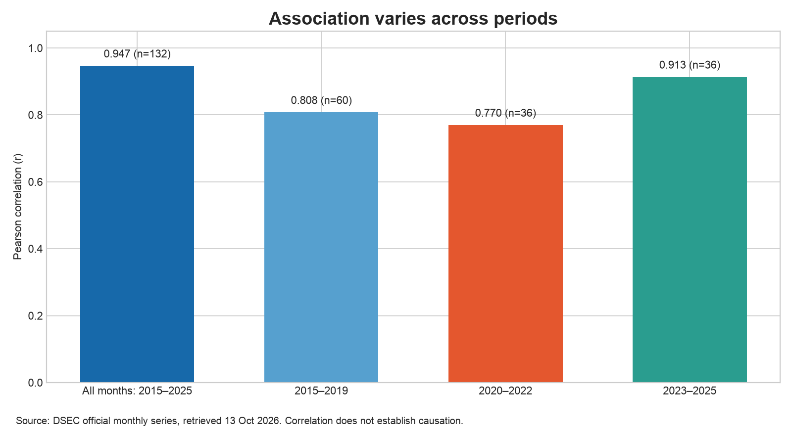

# Visitor Arrivals and Hotel Occupancy in Macao

An ongoing data science project presented by **Ding Huiyuan**, for CISC7204 Practice 09.

## Research question

How did monthly visitor arrivals relate to hotel occupancy rates in Macao from January 2015 to December 2025?

The purpose is to describe the association between tourism volume and hotel use, including differences before, during, and after the 2020–2022 disruption. This is exploratory analysis, not a causal or forecasting model.

## Data source and usage permissions

Source: **Statistics and Census Service (DSEC), Government of the Macao SAR**.

- [Official Time Series Database](https://www.dsec.gov.mo/ts/)
- Indicator **14023**: Tourism and services → Tourism → Visitors → Visitor Arrivals → Number of visitors in and after 2008 → Visitors → By Mode of Transport (total; number of arrivals).
- Indicator **13005**: Tourism and services → Tourism → Hotel establishments → Average occupancy rate (total; percent).
- [DSEC Tourism Statistics, Whole Year and Q4 2025](https://www.dsec.gov.mo/getAttachment/499c7a1c-4b70-439e-a650-268f33dc0d27/E_TUR_FR_2025_Q4.aspx), page 1, states: “Reproduction of these data is allowed provided the source is quoted.” Attribution is retained here and in the figures. No Creative Commons licence is claimed.

The complete official API response was retrieved on **13 October 2026**, retained in `data/raw/dsec_2015_2025.json`, and converted to `data/macao_tourism_2015_2025.csv`. It contains 132 monthly observations, one per month, with no missing values. Both original project series were compared against this response: all 264 values matched.

The source snapshot is included so reproduction does not depend on a live website. Public aggregate statistics are used; no individual visitor or hotel records are included. Earlier provisional DSEC publications can differ from the current database: for example, the December 2015 release reports 82.8% occupancy, whereas the current API returns 83.5%. This analysis uses the retained current database consistently rather than mixing releases.

Optional refresh: `python fetch_data.py`. This replaces the retained snapshot and merged CSV with a new official response; review any revisions and rerun the analysis before updating the published results. The API route and request are recorded in the script.

## Methods and tools

Python, pandas, NumPy, and Matplotlib are used to:

1. Parse and align the monthly series; check completeness, uniqueness, ranges, and exact agreement with the frozen official response.
2. Calculate descriptive statistics and Pearson correlations.
3. Plot aligned time series, a scatter plot with a fitted line, and period-specific correlations.

All findings below are calculated from the included data. The fitted line is descriptive; it is not a validated prediction model. No significance or causal claim is made.

## Key findings

Across all 132 months, visitor arrivals and hotel occupancy are positively associated (**Pearson r = 0.947**). Both series fell during 2020–2022 and subsequently recovered. The association is also positive within each selected period, but its strength varies:

| Period | Months | Pearson r |
| --- | ---: | ---: |
| 2015–2025 | 132 | 0.947 |
| 2015–2019 | 60 | 0.808 |
| 2020–2022 | 36 | 0.770 |
| 2023–2025 | 36 | 0.913 |

### Monthly trends


Separate panels preserve the different units while a shared date axis shows the timing of the disruption and recovery.

### Relationship between the variables


Months with more arrivals generally have higher occupancy. The two colours show how exceptional 2020–2022 was; the fitted line summarizes association only.

### Comparison across periods



The full-period correlation alone can hide differences between periods. The comparison provides context without removing the disruption from the dataset.

## Limitations

**Correlation does not establish causation.** Common trends, seasonality, public policy, travel restrictions, room supply, and serial dependence are not fully controlled. The COVID-19 disruption may affect the overall correlation. The data are monthly and aggregated, so individual visitor behaviour cannot be inferred. Total arrivals include same-day visitors, who may not use hotels. Monthly occupancy is not the same as an unweighted annual mean. Historical statistics can be revised, and hotel-sector definitions should be checked when extending the study.

## Next improvements

Next steps are to examine overnight arrivals and room supply, compare seasonal and lagged patterns, and document changes in series definitions. This wider project remains **ongoing**.

The comparison for 2015–2019, 2020–2022, and 2023–2025 is already implemented; it is not listed as unfinished work. The [data dictionary](data/README.md) explains the merged variables, units, and source indicators.

## Reproduce the analysis

Use **Python 3.11 or later**. From the root of this repository:

1. Download and extract this repository's ZIP from **Code → Download ZIP**, or clone the repository. Open a terminal in the extracted repository folder.
2. Create and activate an isolated environment, then install the dependencies and run the script:

```bash
python -m venv .venv
source .venv/bin/activate
# Windows PowerShell: .venv\Scripts\Activate.ps1
python -m pip install -r requirements.txt
python analysis.py
```

3. Check the terminal output and generated files. The script uses paths relative to its own location and runs without downloading data. It generates three PNGs in `figures/`, descriptive statistics and correlations in `results/`, and `results/metrics.json`. It raises an error if the data checks fail. Expected output includes `Pearson correlation for all 132 months: r = 0.947` and `All data checks passed`.

The environment used for verification is recorded in `VALIDATION.md`. Reproduction here means rerunning the numerical analysis and generating the figures from the retained dataset; it does not mean independently repeating the original government surveys.

## Project origins and attribution

This portfolio adapts the **CISC7204 Assignment 01 Preliminary Project Proposal**, a pair project by Ding Huiyuan and Duan Qingru. The proposal assigns Ding Huiyuan coordination, data preparation, and Notebook maintenance, and Duan Qingru source verification and visualization review; these are proposal roles, not a claim that every planned task was completed. The original proposal and notebook are retained in the [original course repository](https://github.com/DingHuiyuan-MC635708/CISC7204-MC635708-2026GitHub/tree/main/cisc7204-Assgn01-2026-MC635708/proposal).

This repository presents the reproducible portfolio version and adds the current official snapshot, automatic validation, saved result tables, and period comparison. Shared work is acknowledged; independent authorship of the original pair project is not claimed. AI assisted preparation of this version, including code adaptation, documentation, and checks; see `AI_USAGE.md`.

## Files

- `analysis.py`: reproducible analysis and plots.
- `fetch_data.py`: optional official-data refresh.
- `requirements.txt`: pinned analysis dependencies.
- `data/`: frozen official response and merged public data.
- `figures/`: three real visualizations.
- `results/`: calculated outputs.

## Peer feedback and improvement

The classmate feedback supplied on 14 October 2026 identified the research question, main finding, and limitation. In response, this version makes **Limitations** and **Next improvements** separate sections, adds a data dictionary, and clarifies the reproduction steps. The requested subperiod analysis was already present and is retained. See [PEER_FEEDBACK.md](PEER_FEEDBACK.md) for the record.

The portfolio is maintained in the [data-science-portfolio repository](https://github.com/DingHuiyuan-MC635708/data-science-portfolio).
